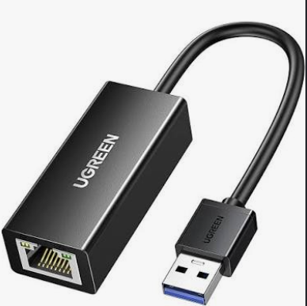

# General Info

Modle: Juniper EX3300
Junos Version:

# Progress

At the moment of making this I have already done a bit of diggging through information and using AI to help resurch how to set the switch up.

I have the PuTTY software and I havent used it yet becuase I have yet to get a console cable.

I am able to make one becasue I have the resources but before I tried using an normal wired RJ45 cable but when I reasurch more I needed to use a diffect wiring scheme

I also need a adapter because the ethernet adapter on my laptop apparently dosen't work for what I am trying to do.

(example of adapter)

10/28/2026

I no longer need the adapter. I will just buy a ethernet to USB, serial adapter 

I researched some more and found out the method I was going to use doesn't work, so I will just get the adapter
